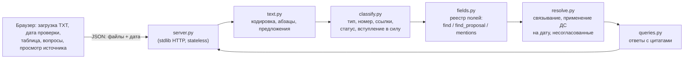

# Сверка условий поставки — прототип

Закупщик загружает TXT-файлы договоров, допсоглашений и писем и сразу видит по каждому
договору **поставщика, сумму и срок поставки на дату проверки**. У каждого значения есть
основание: файл, точная цитата и переход к абзацу исходного текста с подсветкой.
Несогласованные изменения (проекты ДС, письма) показываются отдельно и в расчёт не входят.

- Без LLM и без внешних зависимостей: только Python 3.10+ и стандартная библиотека.
- Ничего не зашито по именам файлов: тип документа, статус и связь с договором
  определяются по тексту, порядок применения ДС — по датам подписания и вступления в силу.
- Если надёжно решить нельзя, система так и говорит: «нет данных» или «требует проверки».

## Запуск

```bash
cd supply-terms-navigator
python -m terms_navigator serve          # открыть http://127.0.0.1:8000
```

В интерфейсе: «Загрузить TXT» (можно несколько файлов или перетащить их в окно) или
«Демо-набор» — шесть учебных файлов из `documents/`. Дата проверки меняется в шапке.

Или в Docker:

```bash
docker build -t terms-navigator . && docker run -p 8000:8000 terms-navigator
```

Тесты (36 сценариев, stdlib `unittest`, меньше секунды):

```bash
python -m unittest discover -s tests -t .
```

## Примеры

**Веб-интерфейс.** Таблица по договорам → клик по 📄 открывает исходник справа на нужном
абзаце, цитата подсвечена, значение выделено. Блок «Вопросы» содержит четыре вопроса из задания
и конструктор (тип вопроса + договор или дата). Строка договора раскрывается: связанные
документы с решением «учтено / не учтено и почему», прежние значения, отброшенные упоминания
(аванс, лимит бюджета, срок оплаты).

**CLI** — то же самое для проверки без браузера:

```text
$ python -m terms_navigator check documents
Дата проверки: 10.03.2026   (* — изменено ДС, ? — требует проверки)
Договор | Поставщик | Сумма договора | Срок поставки | Несогласовано
STN-101 | ООО «Вектор Прибор» | 1 380 000 ₽ * | 30.04.2026 * | 2
STN-102 | ООО «Контур Электро» | 840 000 ₽ | 20.03.2026 | 1
STN-103 | ООО «ПромСнаб Сервис» | нет данных | 30.04.2026 | 0

$ python -m terms_navigator ask documents amount STN-103
Какова сумма договора STN-103?
→ STN-103 — сумма договора: нет данных
  · Что сказано в договоре: «2.1. Общая стоимость определяется спецификацией в приложении № 1.»  [04_contract.txt, п. 2.1]
  · Значение определяется приложением/спецификацией, которых нет среди загруженных документов
  · Не использовано: 600 000 ₽ — лимит/бюджет, а не согласованная стоимость договора  [04_contract.txt, п. 2.2]

$ python -m terms_navigator ask documents deliveries_before 2026-04-01
→ Раньше 01.04.2026: STN-102 (20.03.2026)
  · STN-102: срок 20.03.2026 (по договору)  [03_contract.txt, п. 3.1]
  · STN-102: предлагается 27.03.2026 — предложение в письме, не согласовано, в расчёте не учтено  [05_supplier_email.txt, абз. 6]
  · STN-101: действует 30.04.2026, предлагается 10.05.2026 — проект ДС, не подписан, не учтено  [06_amendment_draft.txt, п. 2]
```

Ответы на вопросы задания (на 10.03.2026):

| Вопрос | Ответ прототипа |
|---|---|
| Срок поставки STN-101 | **30.04.2026** — изменён ДС № 1 (подписано и в силе с 01.03.2026); проект ДС № 2 (10.05.2026) не учтён |
| Сумма STN-102 | **840 000 ₽** с НДС; 252 000 ₽ — аванс, входит в сумму, не используется как стоимость |
| Сумма STN-103 | **нет данных** — стоимость в приложении № 1, которого нет; 600 000 ₽ — лимит бюджета |
| Поставки раньше 01.04.2026 | **STN-102** (20.03.2026); письмо поставщика предлагает 27.03.2026 — не согласовано |

## Известные ограничения

- Только TXT (UTF-8 или Windows-1251) «общего формата» задания: заголовок первой строкой,
  строка `Статус:`, нумерованные пункты. PDF/DOCX/сканы — вне объёма.
- Извлечение на правилах: незнакомая формулировка даст «нет данных» или «требует проверки»,
  а не значение. Это осознанный выбор (см. записку), но покрытие новых формулировок ограничено.
- Один конечный срок поставки на договор; поэтапная поставка → «требует проверки».
- Сумма — в рублях. Поставщик берётся из `Поставщик: …`; имена с точками («ИП Иванов И.И.») обрезаются.
- Связь документа с договором — только по номеру договора; поставщик не сверяется.
- В письме не проверяется, совпадает ли «старый» срок из письма с действующим.
- Нет хранилища: файлы живут во вкладке браузера, после перезагрузки их нужно загрузить снова.

---

## Записка

### Для кого

Специалист по закупкам, который сверяет условия поставок по пакету документов на конкретную
дату: сколько стоит договор и когда должна быть поставка с учётом подписанных изменений.
Ему важна не «умность», а **доверие**: каждое значение можно проверить за один клик,
а сомнительное не выдаётся за установленное.

### Пять вопросов клиенту перед развитием

1. Откуда реально приходят документы (СЭД, почта, ЭДО, сканы) и где «истина» о подписании —
   в тексте документа, в карточке СЭД или в ЭДО?
2. Какие условия кроме суммы и срока влияют на решения закупщика (неустойка, этапы поставки,
   условия оплаты, валюта)? Что он делает с результатом дальше — письмо поставщику, отчёт, задачу?
3. Кто и как разрешает спорные случаи? Нужно ли фиксировать «проверено человеком» для аудита?
4. Объёмы и ритм: сколько договоров и ДС в месяц, нужна ли разовая сверка или постоянный
   контроль сроков с напоминаниями?
5. Ограничения ИБ и инфраструктуры: только локальное развёртывание? Допустимы ли внешние LLM API?
   Как разграничен доступ к договорам (подразделения, контрагенты, гриф)?

### Принятые допущения

- Статус подписания берётся из строки `Статус:` документа — другого источника в задании нет.
- ДС меняет условия, только если подписано обеими сторонами не позже даты проверки **и**
  вступило в силу к ней. Нет даты подписания или вступления в силу → не применяем, «требует проверки».
  «Вступает в силу с момента подписания» → дата вступления = дата подписания.
- Письмо никогда не меняет условия, даже если в нём написано «согласовано».
- Порядок ДС — по дате вступления в силу, затем подписания, затем номеру ДС. Два действующих ДС
  с одной датой и разными значениями → «требует проверки».
- Сумма — итоговая стоимость договора; если цифры и пропись расходятся → «требует проверки».
  Авансы, лимиты бюджета, неустойки суммой договора не считаются.
- Дата проверки по умолчанию — 10.03.2026 (из задания), меняется в интерфейсе и CLI.

### Две метрики

1. **Точность показанных значений** (precision) на размеченной выборке: доля значений,
   выданных как установленные, которые совпали с эталоном. Цель — ≥ 99 %: уверенная ошибка
   дороже «требует проверки». В паре смотрим **покрытие** — долю полей, где значение есть
   в документах и система его выдала, — чтобы не «перестраховываться» бесконечно.
2. **Время сверки договора** (медиана, от загрузки пакета до ответа) и доля значений,
   принятых пользователем без исправления — на пилоте, в сравнении с ручной сверкой.

### Архитектура



Договор даёт базовые значения, допсоглашения — «события» с датой подписания и вступления
в силу. Условия на дату — результат применения подходящих событий; остальные события
попадают в «несогласованные изменения» с причиной.

### Три ключевых решения и компромиссы

1. **Правила вместо LLM в основном контуре.** Плюсы: детерминизм, точные цитаты by design,
   нет выдуманных значений, работает офлайн и бесплатно, полностью покрывается тестами.
   Минус: хрупкость к новым формулировкам и ниже покрытие. Смягчение: при сомнении —
   «требует проверки». Путь развития — LLM как генератор кандидатов, правила как верификатор
   (цитата должна дословно найтись в тексте, значение — внутри цитаты).
2. **Извлечение отделено от разрешения на дату.** Экстракторы находят кандидатов с
   основаниями, `resolve.py` решает, что действует. Плюсы: смена даты проверки ничего не
   переизвлекает, видна история значений, новое поле добавляется одним `FieldSpec` и
   автоматически получает учёт ДС, цитаты и UI. Минус: нужен надёжный разбор статуса и дат
   вступления в силу — при неполных данных растёт доля «требует проверки».
3. **Stateless-сервер на стандартной библиотеке.** Плюсы: ноль зависимостей, запуск одной
   командой, данные не сохраняются на сервере. Минус: каждый запрос заново обрабатывает все
   файлы, нет истории, совместной работы и прав — для прототипа на десятки документов это
   приемлемо, для продукта нет (см. ниже).

### 100 000 документов и права доступа

- **Конвейер загрузки вместо обработки в запросе:** коннектор к СЭД/хранилищу → очередь →
  воркеры (конвертация/OCR → разбор → извлечение) → PostgreSQL: документы, абзацы, факты
  `(договор, поле, значение, цитата, смещения, версия экстрактора)`, связи договор↔документ.
  Идемпотентность по хешу содержимого, переобработка только изменённого.
- **Условия на дату** считаются по фактам в БД (индексы по договору, полю, дате вступления),
  «текущие условия» материализуются и пересчитываются при новом ДС.
- **Поиск:** полнотекстовый (OpenSearch или PostgreSQL FTS) по абзацам + фильтры по извлечённым
  полям; семантический/гибридный поиск — для свободных вопросов, но значения полей всегда
  берутся из проверенных фактов.
- **Связывание:** номер договора не уникален между юрлицами → ключ «ИНН контрагента + номер +
  дата»; неоднозначные связи уходят в очередь ручной проверки.
- **Права:** ACL на уровне документа, унаследованные из СЭД, применяются фильтром в запросе
  к БД и индексу (row-level security), а не постфильтрацией. Отдельное продуктовое решение —
  что показывать, если значение изменено документом, к которому у пользователя нет доступа.
  Журнал просмотров и ручных решений для аудита.
- **Качество:** регрессионный размеченный набор в CI, версия экстрактора у каждого факта,
  мониторинг доли «требует проверки» и «нет данных» по источникам.

### Три следующих улучшения (по приоритету)

1. **DOCX и PDF с текстовым слоем, приложения и спецификации.** Без этого не начать пилот на
   реальных документах; заодно закроется «нет данных» по суммам из спецификаций.
2. **Подтверждение и исправление значений человеком с журналом.** Очередь «требует проверки»,
   фиксация решения и автора. Это и рабочий инструмент для аудита, и источник размеченных
   данных для метрик.
3. **LLM-кандидаты с верификацией** для незнакомых формулировок: локальная модель предлагает
   значение и цитату, правила проверяют, что цитата есть в тексте дословно, а значение внутри
   неё. Без подтверждённой цитаты кандидат отбрасывается.

---

## Отчёт о вайбкодинге

**Инструмент:** Claude Code (агентный режим в терминале и десктоп-приложении) — планирование,
код, тесты, запуск сервера и проверка интерфейса во встроенном браузере. В репозитории оставлены
[`CLAUDE.md`](CLAUDE.md) с инвариантами проекта и командой [`/add-field`](.claude/commands/add-field.md):
это контекст, с которым агент работает в следующих сессиях (в том числе при доработке на встрече).

**Характерные запросы:**

1. *«Прочитай задание и шесть документов. До кода выпиши все ловушки в данных — что выглядит
   как сумма или срок, но им не является, и какие документы не должны менять условия. Предложи
   архитектуру без LLM, где у каждого значения есть точная цитата. Если считаешь, что LLM здесь
   нужна, — аргументируй.»*
2. *«Напиши тесты, которые сломают наивное решение: переименованные файлы, обратный порядок
   загрузки, ДС со вступлением в силу после даты проверки, ДС, подписанное одной стороной, сумма
   цифрами ≠ прописью, cp1251, новый договор того же формата. Сначала только тесты.»*
3. *«Открой интерфейс в браузере и пройди как закупщик: задай четыре вопроса, нажми каждую
   ссылку-основание в ответах и проверь, что открывается нужный файл и подсвечен нужный абзац.»*

**Ошибки ИИ и как они найдены:**

- *Разбиение на предложения отрывало номер пункта.* «3.1. Поставщик…» резалось после «3.1.»,
  цитаты теряли номер пункта, а цитата из ДС («1. Пункт 2.1 изложить… «…»») разваливалась на части.
  Поймал юнит-тест `test_text.py` на реальной формулировке; исправлено проверкой «перед точкой
  только номер пункта».
- *Неверная ссылка в интерфейсе.* Основания хранились в глобальном массиве по индексу и
  обнулялись при перерисовке, поэтому клик по ссылке на письмо открыл строку статуса ДС.
  Тесты бэкенда этого не видят — нашёл при ручном прогоне в браузере; основание теперь
  хранится в атрибуте самой кнопки.
- *«Текущее значение» в несогласованном изменении считалось до применения подписанного ДС*
  (по STN-101 показывалось «сейчас 1 200 000 ₽» вместо 1 380 000 ₽). Заметил на ревью кода,
  исправил порядок: сначала применяем действующие ДС, потом собираем несогласованные.
- Регулярное выражение номера требовало минимум два символа, и «ДС № 1» оставалось без номера
  (ломало сортировку ДС при равных датах). Видно по отладочному выводу метаданных документов.

**Как проверял:** 36 автотестов (вопросы задания, инвариант «цитата — точная подстрока абзаца»,
независимость от имён и порядка файлов, статусы и даты ДС, отрицательные случаи), ручные
«мутации» документов (сдвиг даты вступления ДС, подписанный проект, другая формулировка срока,
удалённый договор) и сквозная проверка интерфейса в браузере.

## Затраты времени

| Этап | Время |
|---|---|
| Разбор задания и данных, ловушки, план | 0:25 |
| Ядро: разбор, классификация, извлечение, сверка на дату | 1:30 |
| Тесты, «мутации» документов, исправления | 0:40 |
| Веб-интерфейс и проверка в браузере | 0:40 |
| README и записка | 0:35 |
| **Итого** | **≈ 3:50** |

**Не сделано за отведённое время:** сверка «старого» срока в письме с действующим,
проверка совпадения поставщика в договоре и ДС, автотесты интерфейса, экспорт таблицы в Excel.
